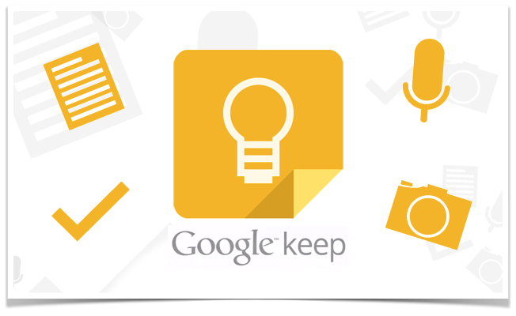

 구글 서비스 Keep

최근에 구글Keep으로 간단한 메모나 텍스트 정보들을 정리하기 시작했습니다.
핸드폰으로 등록된 메모도 웹브라우져에서 확인가능하네요!

등록된 메모중 다시 내용을 모아서 에버노트에 노트로 저장을하고
다시 새로운 메모들로 구글 Keep를 채웁니다.

구글 Keep UI는 간단한 메모나 목록만들기에는 정말 좋은거 같습니다.
TODO List 도 이제부터 구글 Keep로 관리해야 겠네요.

우선 급하게 메모해야할 간단한 텍스트들도 구글 Keep에 저장해 놓고
나중에 다시 정리해야겠네요!!!
