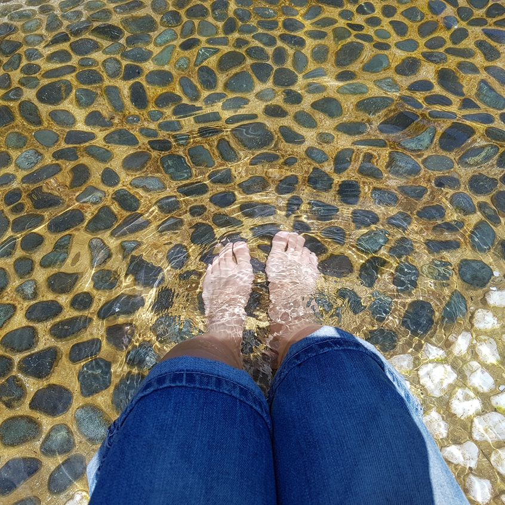
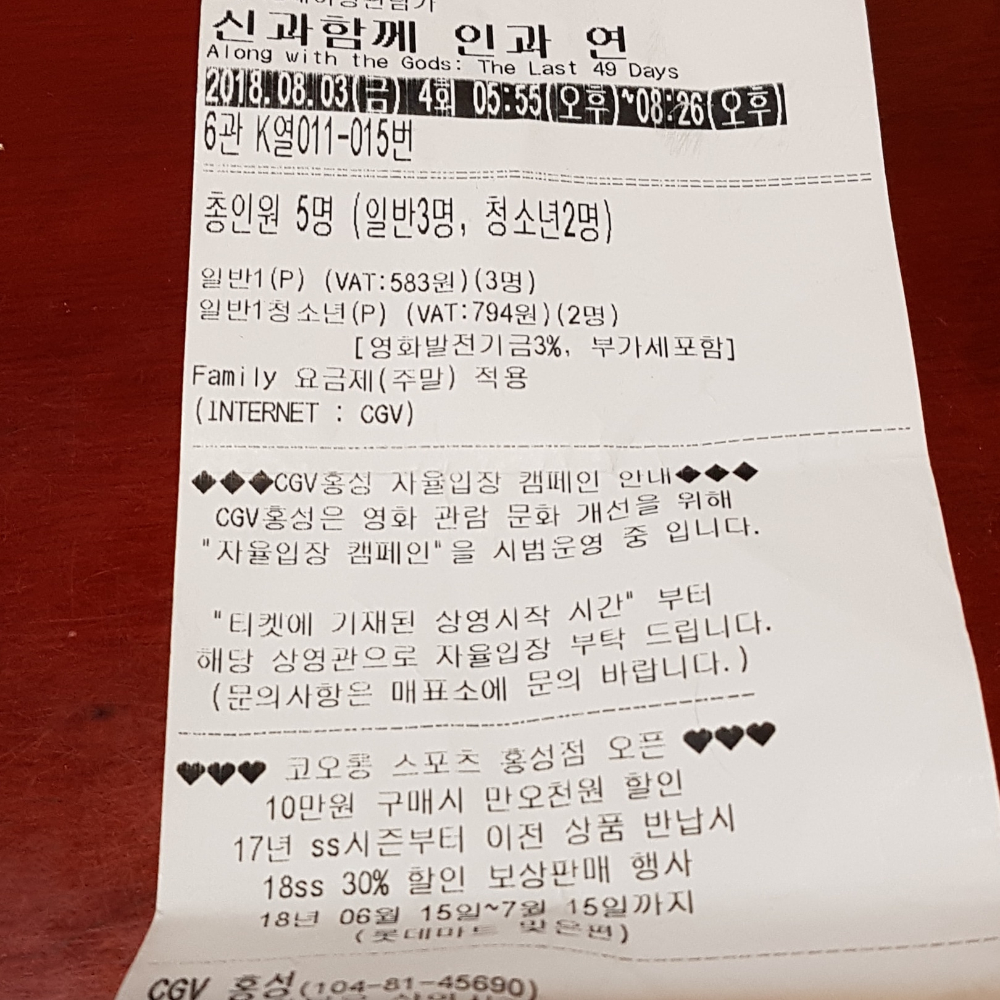
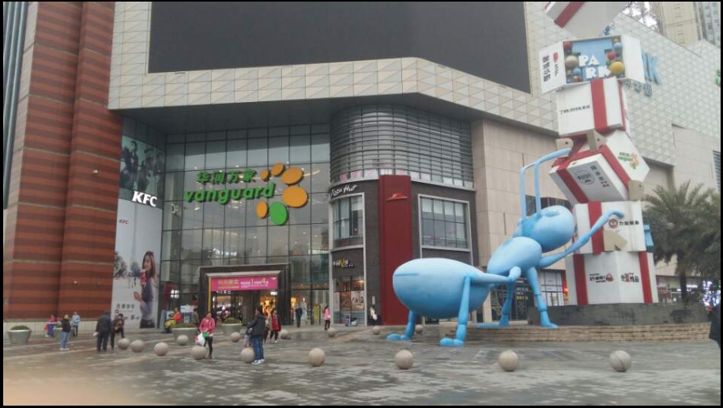

### # 여름휴가

8월 1일~3일 출장나온 서산 공장에 정전이 있어 휴가를 내고 가족과 함께 여름휴가를 보냈습니다.

매년 여름휴가는 처갓집에서 보내거나 여행을 가는데 이번 여름휴가는 처갓집에서 보내기로 하고 서산 숙소에서 기다린 후 집사람이 저를 데리러 왔습니다.

처갓집은 서산 지나서 광천입니다. <strong>대천해수욕장에 30분 거리에 있죠!!</strong>

최근 엄청난 더위 때문에 서울은 엄청 덥다고 하는데 광천 처갓집도 엄청 더웠네요. 그래도 즐거운 여름휴가를 보내고 왔습니다.  

* 첫째날 보령 냉풍욕장  작년에 보령 냉풍욕장에 처음 갔을때 엄청 시원했던 기억에 이번 여름휴가에도 냉풍욕장에 다녀 왔습니다.  첫째날도 엄청 더운날이었는데 냉풍욕장에 들어가니 엄청 시원했습니다. 집사람은 춥다고 하고 온도계에 12도 라고 표시되어 있네요. 사람들도 많이 시원하다고 하고 더운 여름에는 최고의 피서지 입니다.

 보령냉풍욕장에서 발을 담그면 30초를 못버텨요!!!

* 둘째날  고추 따기 처갓집에서 놀고 얻어 먹기만 할수 없어서 고추 따는것을 좀 도와 드렸습니다.
* 셋째날  영화관람 - 더위에는 시원한 영화관에서 온가족이 영화관람을  <strong>"신과함께2 - 인과연"</strong> 을 온가족이 관람하였습니다.  너무 재미있었고 정말 시원했습니다.

* 넷째날 대천해수욕장 물놀이 - 여름휴가인데 물놀이가 빠지면 안될꺼 같아서  서울 올라가기 전에 대천 해수욕장에 가서 물놀이를 하고 왔습니다.  낮에는 많이 더울꺼 같아서 오전에만 하고 왔는데 아이들이 정말 좋아하고 바닷물에 몸을 담그니 시원했습니다. 매년 한번씩 가는 대천 해수욕장인데 참 좋은거 같아요!!! 

### # 중국 출장

중국 출장 출국일정이 잡혔습니다. 9월 3일 중국 후이저후로 출발 합니다. 직항이 없어서 심천공항으로 비행기를 타고 가고 심천 공항에서 1시간 반정도 차를 타고 가야 한다네요. 해외 첫 출장 어떤 느낌일지 굉장히 기대가 됩니다.

숙소로 잡은곳 주변 음식점도 검색을 하고 중국에서 주의할점도 공부하고 주말에는 무엇을 할지 고민하면서 보내고 있습니다. 역시 해외 출장은 준비할께 많네요. 나중에 준비과정을 하나 포스팅해야 겠습니다.

 중국 숙소가 있는 건물 사진

