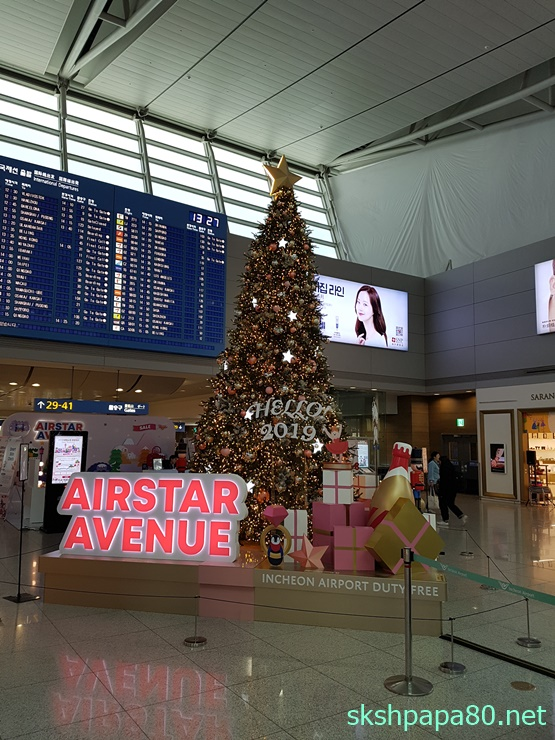
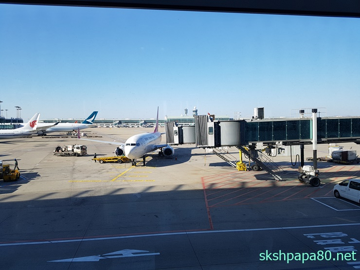

### 2달만에 한국

2달만에 한국에 다녀왔습니다. 12월 22~29일 약 일주일동안 한국에 갔다가 다시 중국 혜주(후이저우)에 왔습니다. 약 60일만에 한국에 다녀오는거라 참 해야 할일도 많고 하고 싶었던일도 많았네요!!! 크리스마스는 가족과 함께 보낼수 있어서 참 좋았습니다.

오랜만에 만난 아이들고 재미있는 시간도 보내고 아빠가 해야 할일도 처리해주고 맛있는 음식도 먹으며 즐거운 시간을 보냈습니다. 역시 다시 중국들어오는날에는 좀 아쉬움도 남았네요. 더 남아 있었으면 하는 바램도 있었습니다.

 인천공항에서 크리스마스 트리

 인천 -&gt; 심천 타고온 비행기

처음 중국에 온 아시아나 비행기만 빼고 계속 심천항공 비행기를 타고 있습니다. 비행시간이 한국에 갈때에는 심천에서 9시40분에 출발하는데 점심 시간에 출발하는 아시아나 비행기를 타면 하루가 다 지나가서 심천항공 비행기를 타고 있습니다. 처음에 걱정도 했는데 잘 타고 다니고 있습니다.

심천항공은 아시아나와 코드쉐어가 되고 아시아나로 마일리지가 쌓입니다. 최근에 아시아나 마일리지를 쌓고 있어서 더욱 좋습니다.  곧 만점이 넘을듯!!!

### 뮤지컬 관람

이번 한국 일정 속에는 온가족이 함께 뮤지컬 관람하는것도 포함되어 있었습니다. 12월 26일 "크리스마스 캐럴" 를 저녁 시간에 관람하였는데요 아이들과 함께 여서 더 욱 재미있었습니다. 두딸들이 엄청 빠져서 재미있게 봐서 참 좋았네요!!!

### 딸바보 아빠

딸바보 아빠라는걸 새삼 다시 깨닫고 왔습니다. 오랜만에 봐서 그런지 아이들이 많이 컸구 정말 이쁘더라구요. 아이들 보고 만 있어도 기분이 좋은게 엄마는 말을 안들어서 힘들다고 하는데 저는 잠깐 본거라 이쁘기만 하네요!!!
