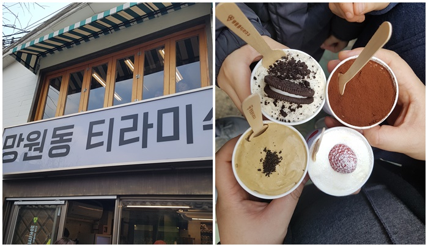

### 익선동

최근 주말에 가족나들이로 종로 익선동에 다녀왔습니다. 인사동, 종로 옆에 있는 동네 인데 사람들이 많이 가는 곳이네요. 낙원상가쪽에서 자주 지나다니면서 저기는 사람들이 많이 다니는구나 라고 생각만 했지 저런곳이 있는줄은 몰랐네요! #익선동

이영자의 맛집 "남도분식" 도 익선동에 있습니다. 주말에 방문하니 사람들이 많네요 줄선 식당도 많고 저희는 점심을 다른곳에서 먹고 가서 아이들이 좋아하는 티라미수 집에서 티라미스를 사먹고 집으로 돌아 왔습니다. 골목이 좁아서 돌아다니기는 좀 힘드네요. 사람들이 정말 많아서 연인들이 정말 많이 오는것 같았습니다.

 망원동 티라미수 맛있어요!

### 연말정산

연말정산의 계절이네요. 경영지원실에서 연말정산 서류를 요청해서 필수서류 작성해서 메일로 보내고 홈텍스에서 편리한 연말정산 제출 완료하였습니다. 편하네요!! 다 자동계산에 따로 수정할 내용이 없어 바로 제공동의 했습니다. 예상액 계산해보니 낼돈도 받을 돈도 없네요. 작년에 1~4개월 쉬어서 그런듯 연봉이 작아져서 그런것 같은데 뭐 낼돈이 없는것도 좋은거 같아요!!!

### 프로젝트 계약

다시 중국에 가게 될지 모른다는 이야기가 나왔는데 아직 최종결정이 되지 않았네요! 다시 중국 혜주(후이저우)에 가게 될지 아니면 새로운 프로젝트에 투입될지 음 빨리 결정이 났으면 좋겠습니다.  중국에 가서 하고 싶은것도 많았는데 그리고 중국에 익숙해질만 할때 철수해서 중국에서의 생활이 그립기도 합니다.
