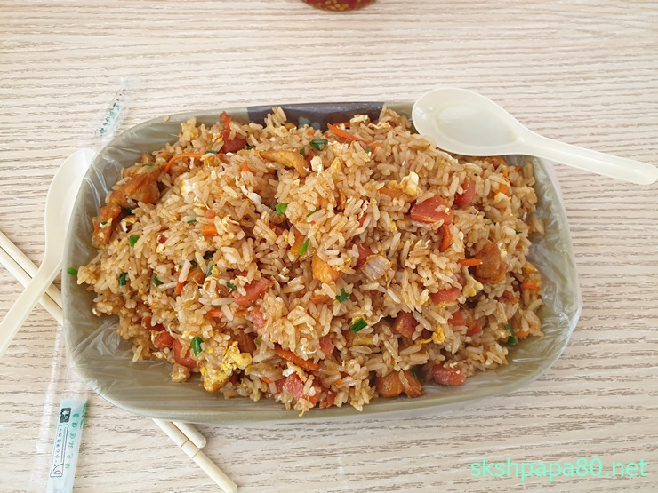

### 중국에서

3월 12일 중국 후이저우로 출장을 왔습니다. 벌써 2주가 지났네요. 시스템 운영지원 업무로 중국으로 출장 온거라서 2주동안 MES 시스템 운영지원을 하느라 정말 바뻤네요. 숙소 인터넷도 이제 신청해서 이제 숙소에서 인터넷이 됩니다. 핸드폰 유심은 필요해서 바로 신청을 했는데 숙소 인터넷은 좀 늦게 되었네요. 인터넷 이랑 유심 모두 합해서 99위안인데 첫달만 99위안이고 둘째달은 69위안 입니다. 싸고 좋아요!!! 이제 교통은행에만 가면 생활에 필요한 기본 준비는 끝납니다.

확실히 해외출장이지만 4달정도 머물렀던 곳이라 금방 적응하겠네요. 중국 출장 준비는 별로 어렵지 않았습니다.

### 날씨

여기 심천공항에 도착하자마자 느꼈지만 역시 더워요. 저한테는 한여름 날씨 입니다. 그나마 비가 오면 좀 시원하기는 한데 더울때에는 완전 여름 날씨 입니다. 아직 30도 넘어 가지도 않았는데 덥다고 느껴지는데 이번여름도 날씨 때문에 많이 고생하겠네요. 그래서 휴대용 선풍기를 하나 구해야 겠네요.

### 식사

 중국 로컬식당 볶음밥 6위안

점심에 공장앞 중국 로컬 음식점에서 차오판을 많이 먹습니다. 첫주에는 이곳저곳에 가서 먹었는데 이번주에는 한곳으로 정해지고 있습니다. 최근에 점심먹으로 간 곳이 차오판은 가장 맛있네요. 우육면도 먹었는데 맛있었습니다. 다음에는 라면 같은것도 먹어봐야 겠네요.
