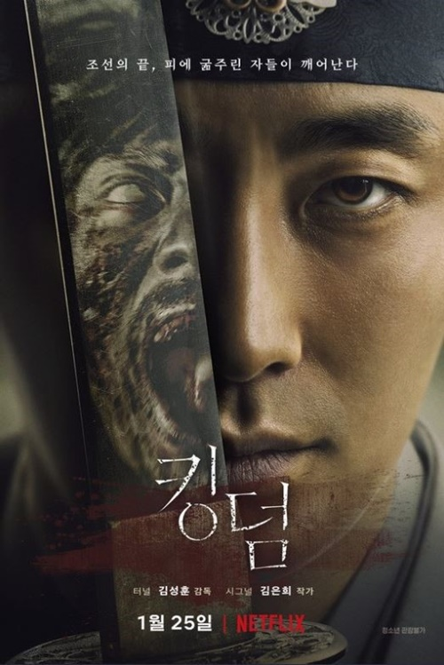

### 넷플릭스

중국에 출장 나와서 심심함에 넷플릭스를 구독중입니다. 최근에 넷플릭스로 감상한 작품 목록입니다.

 2018년 방영된 유성화원 주인공들

* 유성화원 중국 출장을 왔으니 중국 드라마를 봐야 겠다는 생각에 넷플릭스 추천에서 고른 드라마 입니다.  일본 드라마 꽃보다남자 리메이크 버전인데 보기보다 재미있게 보았습니다.  어떻게 보면 신데렐라 스토리의 변현인데 평범하지만 당찬 여주인공이 대학교에 입학하고 학교에서 킹카들이라 불리는 "F4"를 만나게 되면서 벌어지는 이야기 입니다. 역시 사랑이야기구교!!! 기본 스토리라인은 꽃보다 남자를 따라가지만 중국이 배경이라 그런지 좀 다른 느낌이 드네요. 여주인공 "심월"은 처음보는데 귀엽네요!!! 다만 최근 드라마 이다 보니 PPL 심하네요!!!

* 아름다운우리에게 유성화원을 보고나서 여배우가 나온 작품으로 검색을 해서 보게 되었습니다.  여배우 이름이 "심월"인데 귀엽고 이쁘네요!!! 남자배우도 멋있구요 남주 이름은 "호일천"입니다.  고등학생들의 사랑이야기인데 중반에 조금 답답한 부분이 좀 있는데 그래도 해피엔딩으로 끝나네요!!!

* 킹덤 최근에 본 한국 드라마중 가장 재미있게 보았습니다. 시리즈가 짧은게 단점이네요. 다음시즌 정말 기대가 됩니다.  주지훈 정말 멋있게 나오네요!!! 배경은 조선시대 그리고 좀비물입니다.  인터넷에서 재미있다고 다들 봤다고 이야기는 들었는데 전 조금 늦게 봤네요. 넷플릭스 구독한지 얼마 안되서요!!!

### 계획

중국에 출장을 왔으니 중국어는 좀 공부를 하고 숙소에 혼자 있으니 시간이 많겠다 해서 중국어 공부도 하고 프로그래밍 공부도 하려고 했는데 계획대로 안되고 계속 넷플릭스만 보고 있네요. 다음달부터는 맘을 다시 잡아서 중국어 공부를 시작해야 겠습니다. 넷플릭스를 그만 봐야 하는데 잘 될지는 모르겠네요!!!

넷플릭스 보고 있으면 계속 추천 프로그램이 나오는데 계속 보게 되네요!! 저랑 맞나봐요...
