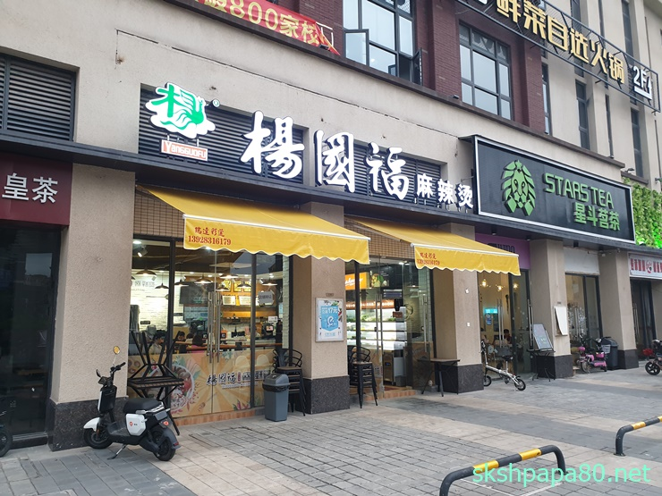

### 한국다녀오기

두달만에 한국에 다녀옵니다. 이번주 토요일에 한국에 들어 갔다가 다음주에 다시 중국으로 돌아옵니다. 두달만이네요. 한국에 가는거. 아이들도 보고 싶고 집에서 쉬고 싶습니다. 중국에 온지 한달정도 되니 한국에 가고 싶다는 생각이 들더라구요. 가족들이 많이 보고 싶습니다. <s>11일 토요일</s>에 이번에는 아시아나 비행기를 타고 한국으로 갑니다.

한국 방문이 연기되었습니다. 일정이 생겨서 비행기 리턴변경하고 1주일 후로 그리고 집에다가 못간다고 이야기 하고 아이들이 기다린다고 하는데 미안하네요. 약소한 날짜에 못가서 해외 출장의 단점인데 한국에 다녀오는 일정 조정하는게 좀 힘듭니다. 출장비가 국내에 비해 많이 받아서 좋긴한데 가족과 함께 못하는 시간이 좀 힘드네요!!!

### 중국의 노동절

중국은 5월 1일 노동절에 쉬고 2,3 일도 쉽니다. 대체 근무제를 운영하여 4월 28일 일하고 5월 5일 일해서 5월 1~3일 쉽니다. 토요일도 쉬니 4일정도 휴가가 생기는거지요. 물론 일요일날 일을 해야 합니다. 이때에는 공장도 생산이 없어서 편히 쉬었습니다.

### 마라탕

한국에서는 마라탕을 먹어본적이 없습니다. 저랑 안맞는 음식이라고 생각해서요. 중국에 와서도 못먹을꺼 같았습니다.

 양쿼푸 - 마라탕 체인점

근데 숙소 근처에 있는 마라탕집이 있습니다. 위사진의 집인데 이곳의 마라탕은 완전 맵게만 아니면 먹을수 있습니다. 제가 재료를 고르고 매운 정도를 이야기 해주면 끌여 주시는데 생각보다 맛있습니다. 그래서 가끔 먹습니다. 숙소와 정말 가깝거든요. 가격도 저렴하고 제가 이것저것 담고 면도 담고 해서 30위안이면 배부릅니다.
