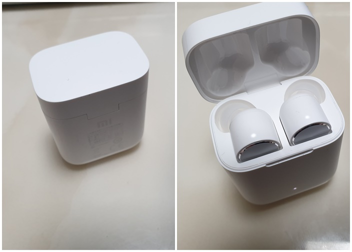

### 한국에 다녀왔습니다.

중국출장에서 완전한 철수가 아니라서 지난주에 한국에 일주일동안 다녀왔습니다.  두달만에 다녀온 한국은 역시 즐거웠습니다. 먹고 싶었던 음식과 가족과 함께 보내는 시간이 정말 즐거웠거든요. 다시 한국에 가려면 2달이 있어야 하는데 벌써 부터 기다려지네요. 다음에는 한여름 아이들이 방학하는 시즌에 맞춰서 나가야 겠습니다. 지난주에는 아이들이 학교에 가서 특별히 어디를 놀러가거나 하지 못했습니다.  그래서 아이들이 방학을하면 같이 1박2일이라도 놀러 가고 싶네요.

### 샤오미 블루투스 이어폰

 샤오미 블루투스 이이폰 "에어닷 프로"

심천공항에서 한국으로 갈때 심천공항에 있는 샤오미 매장에 구경을 갔습니다. 거기에서 블루투스 이어폰을 봤는데 디자인이 괜찮고 시착했을때 맘에 들어서 구매했습니다. 약간 충동구매였는데. 지금까지 잘사용하고 있습니다. 우선 충전함에 꽃으면 자동으로 OFF 되고 귀에 꽃으면 자동으로 ON 됩니다. 중국어 버전이라 중국어로 안내가 나오는거 빼고는 좋은거 같습니다. 통화도 잘되고 유선 이어폰 사용하다 무선 이어폰 사용하니 확실히 편하네요. 걸리적 거리는것도 없고!!!!

### 샤오미 에어닷 프로 사용법

* 페어링은 충전케이스의 버튼으로 합니다.
* 왼쪽 2번 클릭하면 빅스비/시리 호출되구요.
* 오른쪽 2번은 일시정지/ 재생 입니다.
* 양쪽 어느쪽이든 3초간 누루고 있으면 노이즈캔슬링 On/Off 됩니다.
* 귀에 끼면 켜지구요. 귀에서 빼면 노래 멈추네요.
