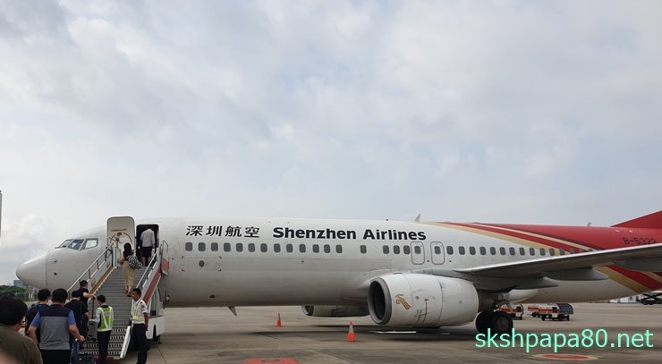
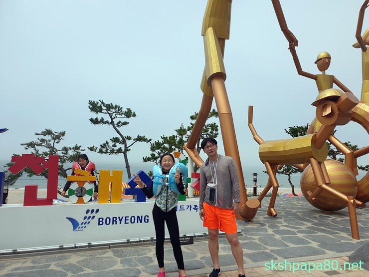

### 한국 다녀오기

07/22 ~ 07/27 일 한국에 다녀왔습니다. 중국 출장을 올해 3월 부터 하고 있으니 앞으로도 많이 남았고. 그래서 중국에서 사는것처럼 한국에 다녀왔습니다. 이제 점점 중국 의 아파트 숙소가 편해지고 있습니다.  이번에도 역시 두달만에 한국에 다녀오는겁니다. 두달에 한번 그리고 일주일 씩 휴가처럼 다녀옵니다.

 한국 가는 비행기 심천항공

이번에 귀국은 여름휴가 그리고 아이들 방학에 맞추어서 한국에 다녀와서 가족들과 함께 보내는 시간이 많았습니다. 그래서 더 좋았어요!!! 오랜만에 처갓집에도 다녀오고 바다(대천해수욕장)에도 다녀오고 전시장(예술에전당)도 다녀오고 맛있는 음식도 많이 먹었습니다.  한국에 오니 먹고 싶은것들이 많아져서!!!

 대천해수욕장에서

보령 머드축제가 진행중인 대전해수욕장에 다녀왔습니다.  처갓집에서 가까워서 주로 여름에 처갓집으로 휴가를 가고 매년 대천해수욕장에 가서 물놀이를 즐깁니다. 아이들도 좋아하고 처갓집이랑 가까워서 더욱 좋습니다. 오랜만에 바닷가에 물놀이를 하니 즐거웠습니다.

### 더위

여기 중국 혜주도 많이 더웠지만 한국도 덥네요. 그래도 에어컨이 많이 있어서 밖에 다닐때 빼고는 더운줄 잘 모르겠더군요. 지하철도 시원하고 식당들도 시원하고 건물에만 들어가면 어쨌든 시원하니까. 잠깐만 더우면 된다는 생각에 더위도 더 버틸수 있는겉 같습니다. 중국은 에어컨은 큰건물에만 있어서 에어컨의 시원함을 느낄수 없습니다.

특히 혜주는 습도가 높아서 더 덥게 느껴집니다. 심천, 해주 여행을 오신분들을 아실껍니다.

### 일본 불매 운동

중국 출장중이라. 일본 불매운동에 대해 잘 느끼지 못하였습니다. 인터넷에는 많이 동참하시는것 같지만 실감이 나지 않는달까요. 하지만 이번에 한국에 가서 확실히 느꼈습니다.

두딸들은 일본 제품은 절대 사지 말아야 한다고 하고 와이프도 일본여행은 절대 안간다고 합니다. 와이프가 안간다고 하지 저는 제돈으로는 일본에 갈일은 없겠네요. 그리고 시내를 돌아다니다 NO JAPAN 불매운동 현수막도 몇개 보았습니다. 일본 불매운동이 정말 많은 사람들이 참여하고 진행되고 있으며 확실한 효과가 나타날꺼 같네요.

저도 중국에서나마 일본 불매운동에 참여해야 겠습니다.
