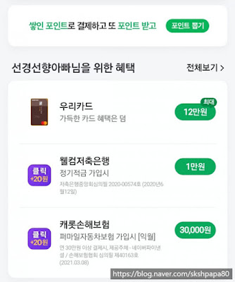
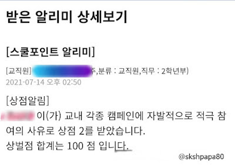

### 07월 07일
#### 성적표

중학생 큰딸의 성적표를 보았습니다.  
1학기 중간고사 1학기 기말고사는 최근에 끝났고 아직 성적이 나오지 않았습니다.  
제가 기억하는 성적표와 다른점은​
* 과목이 적고
* 석차가 없네요
* 평균 점수만 있는데 학년평균인지 반평균인지​

공부를 잘했으면 하는 바램은 있지만  
맘처럼 되진 않겠지요

#### 인터넷 폐지줍기

웹서핑을 하다가  
클릭하면 네이버 포인트를 얻는 글이나 링크를 봤습니다.  
찾아보니 네이버 앱에 -> 네이버 페이에  
요런 부분이 있네요.

저기서 클릭하면 네이버페이가 적립이 됩니다.  
이걸 인터넷 폐지 줍기라고 하네요 ㅎㅎ  
재미있어요 !!!!

### 07월 12일
#### 코로나 4단계
확진자 수가 1300명이 넘어서 수도권은 오늘부터 코로나 4단계로 넘어갔네요. 백신을 접종하기 시작하고 점점 줄어들기를 바랐는데 다시 늘어나더니 결국 1300명이 넘었어요. 

날씨가 더워져서 KF-AD 등급의 마스크로 변경하려고 했는데 계속 KF-94 등급의 마스크를 유지해야겠네요. 

해외 출장을 가기 위해 코로나 검사를 받았고 갔다 와서 격리하면서 받았고 꽤 많이 코로나 검사를 했는데 결과는 모두 음성. 코로나가 시작된 지 시간이 많이 흘렀는 데 아직 안 걸린걸 다행으로 생각합니다. 지금 걸리면 좀 억울할 거 같아요 계속 마스크 쓰고 다니고 사람들과 거리를 두면서 안 결렸는데 좀 있으면 백신도 맞는 데 코로나에 걸리면 지금까지 고생한 게 한 번에 날아가 버릴 거 같은 느낌

다시 예전처럼 500~600명대로 낮아지길 바랍니다. 당분간 방역수칙을 열심히 지켜야겠습니다. 

#### 상벌점
큰딸이 학교에서 상벌점 점수를 많이 받았어요! 책을 많이 읽고 교내 캠페인 등 참여를 잘하고 학교에서 선생님 말씀을 잘 들으니 상점이 계속 올라가네요. 80점이 넘어가면서 처음 상벌점을 받아을 때랑은 느낌이 다르지만 그래도 소중한 점수인 거 같아요

아이가 학교생활을 열심히 하고 있다는 증거가 되는 거 같아서 마음이 좋습니다. 

작은 딸은 바른 어린이 상을 받는다는데 집에서는 말을 잘 안 듣지만 학교생활은 바르게 하고 있다고 하니 제가 다 선물 받은 기분이네요!!!

### 07월 21일
#### 주말부부 

최근에 주말부부로 지내고 있어요 일요일 저녁에 지방으로 내려갔다가 금요일 저녁에 서울로 올라오고 

주말에는 집에서 보내다가 주중에는 출장지에서 보내는 생활

해외 출장이 아니라서 장기간 가족을 못 보는 게 아니라 주말에는 보기 때문에 집사람과 아이들은 나쁘지 않은 듯 아이들도 바쁘고 집사람도 바쁘고 

단점은 주중에 퇴근 후에 지방 숙소에서 좀 심심하다는 거 맨날 넷플릭스 보는 것도 이제 별로 재미가 없고 잠도 많이 자면 새벽에 깨서 다음날 힘들고 그리고 저녁식사를 월요일~목요일은 혼자 먹으니 그냥 대충 먹게 된다. 

집사람이 이것저것 많이 싸줘서 그래도 챙겨 먹는데 아마 그거라도 없으면 맨날 라면만 먹을 듯 코로나라 식당에 가서 먹는 것도 그렇고 1인분 배달은 힘드니까 ㅎㅎ

앞으로 3달은 계속 이런 생활을 유지할 듯 ㅎㅎ

PS. 밤에 시간이 많으니 사이트 프로젝트 하나 진행해야 하는데 잘 안되네요 ㅎㅎ